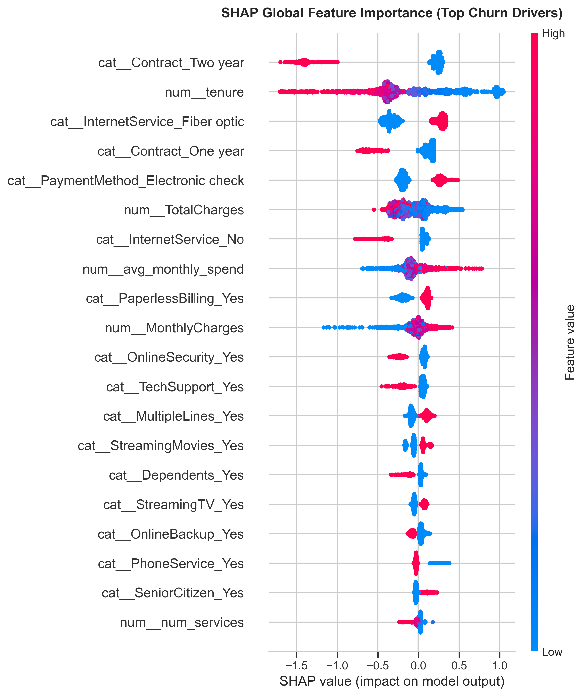

# Bye Bye Churn: Customer Churn Prediction & Retention Dashboard


An end-to-end machine learning project that predicts **which telecom customers are likely to churn**, ranks them by risk, estimates the **revenue at risk**, explains **why** each customer is at risk, and delivers everything through an interactive **Streamlit dashboard**.

> **Live demo:** [bye-bye-churn-app](https://bye-bye-churn.streamlit.app/)

---

## Table of Contents

1. [Business Problem](#business-problem)
2. [What We Built](#what-we-built)
3. [Key Results](#key-results)
4. [Dataset](#dataset)
5. [Methodology](#methodology)
6. [Explainability with SHAP](#explainability-with-shap)
7. [Risk Scoring and Revenue at Risk](#risk-scoring-and-revenue-at-risk)
8. [Dashboard](#dashboard)
9. [Project Structure](#project-structure)
10. [Getting Started](#getting-started)
11. [Using the Trained Model](#using-the-trained-model)
12. [Limitations](#limitations)
13. [Future Work](#future-work)
14. [Team](#team)
15. [Acknowledgements](#acknowledgements)

---

## Business Problem

For telecom and subscription businesses, losing existing customers is expensive, and the business usually does not know **who is about to leave** until it is too late. Retention offers cost money, so they must go to the right customers.

This project answers four questions:

1. Which customers are most likely to churn?
2. How much revenue is at stake?
3. Why is each customer at risk?
4. Where should the retention budget go first?

---

## What We Built

| Deliverable | Description |
|---|---|
| Cleaned dataset and EDA | Data quality fixes and churn patterns by contract, tenure, services and charges |
| Tuned and calibrated ML model | XGBoost pipeline selected after comparing against tuned Logistic Regression |
| Risk scores | Every customer gets a churn probability, a risk band and a ranked position |
| Revenue at risk | Expected monthly and annual revenue loss per customer and per segment |
| SHAP analysis | Global drivers of churn and top reasons per customer |
| Streamlit dashboard | Executive overview, risk explorer, Customer 360, what-if simulator, retention planner, model health, SHAP page |

---

## Key Results

### Baseline model comparison (default settings, 5-fold stratified CV on the training set)

| Model | Imbalance handling | PR-AUC (mean) | PR-AUC (std) | ROC-AUC | Recall | Train PR-AUC |
|---|---|---|---|---|---|---|
| Logistic Regression | None | 0.6570 | 0.0183 | 0.8455 | 0.5465 | 0.6654 |
| Logistic Regression | Class weights | 0.6556 | 0.0185 | 0.8455 | 0.7987 | 0.6625 |
| Random Forest | None | 0.6231 | 0.0306 | 0.8263 | 0.4876 | 0.9998 |
| XGBoost | `scale_pos_weight` | 0.6230 | 0.0245 | 0.8223 | 0.6528 | 0.9848 |
| XGBoost | None | 0.6181 | 0.0233 | 0.8202 | 0.5070 | 0.9780 |
| Dummy | None | 0.2654 | 0.0001 | 0.5000 | 0.0000 | 0.2654 |

With default settings, Random Forest and XGBoost overfit (train PR-AUC near 0.98 to 1.0), so both Logistic Regression and XGBoost were **hyperparameter-tuned** before the final decision.

### Tuned models (final comparison)

> Fill this table from your notebook output before publishing.

| Model | PR-AUC (CV) | ROC-AUC (CV) | Recall | Precision | Brier score | Test PR-AUC | Test ROC-AUC | Test Recall |
|---|---|---|---|---|---|---|---|---|
| Tuned Logistic Regression (calibrated) | `0.6570` | `0.8455` | `79.87%` | `0.53` | `0.1645 (OOF) / 0.1384 (Test)` | `0.6332` | `0.8409` | `71.66%` |
| **Tuned XGBoost (calibrated)** | `0.6652` | `0.8223` | `65.28%` | `0.4528` | `0.1384 (Test)` | `0.6612` | `0.8459` | `88.50%` |

**Selected model: tuned and calibrated XGBoost**, because after tuning it delivered the **higher recall** and the **better fit** on validation data. In a churn setting, missing a customer who leaves costs more than contacting one who would have stayed, so recall carries extra weight.

---

## Dataset

**Telco Customer Churn** (IBM sample dataset)

- Source (Kaggle): https://www.kaggle.com/datasets/blastchar/telco-customer-churn
- Original IBM repository: https://github.com/IBM/telco-customer-churn-on-icp4d
- 7,043 customers, 21 columns
- Target: `Churn` (Yes/No), roughly 26.5% churners (about 2.8 : 1 class imbalance)

| Group | Columns |
|---|---|
| Demographics | gender, SeniorCitizen, Partner, Dependents |
| Account | tenure, Contract, PaperlessBilling, PaymentMethod, MonthlyCharges, TotalCharges |
| Services | PhoneService, MultipleLines, InternetService, OnlineSecurity, OnlineBackup, DeviceProtection, TechSupport, StreamingTV, StreamingMovies |

> **Note:** the `Churn` label is a historical flag (the customer left in the last month). The dataset has no explicit 30 to 60 day time horizon, so the model outputs a **churn risk score** that is used to prioritise retention actions.

Download the file into `data/raw/` (it is not modified afterwards):

```bash
curl -L -o data/raw/Telco-Customer-Churn.csv https://raw.githubusercontent.com/IBM/telco-customer-churn-on-icp4d/master/data/Telco-Customer-Churn.csv
```

---

## Methodology

```mermaid
flowchart LR
    A[Raw Telco data] --> B[Cleaning and EDA]
    B --> C[Feature engineering and preprocessing]
    C --> D[Stratified 80/20 split]
    D --> E[5-fold CV: Dummy, LR, RF, XGBoost]
    E --> F[Hyperparameter tuning: LR and XGBoost]
    F --> G[Probability calibration]
    G --> H[Model selection: XGBoost]
    H --> I[Final test evaluation]
    I --> J[SHAP and risk scores]
    J --> K[Streamlit dashboard]
```



### 1. Data cleaning and EDA

- Converted `TotalCharges` to numeric (11 blank values belong to customers with `tenure = 0`)
- Standardised categories such as `No internet service` and `No phone service`
- Explored churn by contract type, tenure bands, internet service, payment method, add-on services and monthly charges
- Checked correlations, skewness and class balance

### 2. Preprocessing and feature engineering

- All preprocessing lives inside a scikit-learn `Pipeline` / `ColumnTransformer`, fitted on the **training data only**, to avoid data leakage
- One-hot encoding for categorical features, scaling for numeric features
- `customerID` is kept only as an identifier and never used as a feature

### 3. Handling class imbalance

- Target `Churn` is imbalanced (about 73.5% No, 26.5% Yes), a mild imbalance
- Used `class_weight='balanced'` (Logistic Regression) and `scale_pos_weight` (XGBoost)
- Evaluated with **PR-AUC, ROC-AUC and Recall** instead of accuracy (a model that always predicts "No" already scores 73.5% accuracy)

### 4. Validation

- Stratified 80/20 train/test split; the test set stays untouched until the final evaluation
- Stratified 5-fold cross-validation on the training set, reporting **mean and standard deviation** for every metric
- Train and CV scores compared side by side to detect overfitting

### 5. Hyperparameter tuning

- **Logistic Regression:** tuned regularisation strength and related settings with cross-validated search
- **XGBoost:** randomised search over tree depth, learning rate, number of trees, subsampling, column sampling, minimum child weight and regularisation
- Both searches optimised PR-AUC with stratified 5-fold CV, on training data only

### 6. Probability calibration

- Class weighting inflates predicted probabilities. Because revenue at risk is computed as `probability x monthly charges`, probabilities must be trustworthy
- Both tuned models were calibrated with `CalibratedClassifierCV` and checked with the **Brier score** and calibration curves

### 7. Model selection

Tuned Logistic Regression and tuned XGBoost were compared on cross-validated PR-AUC, ROC-AUC, recall, calibration quality and stability. **XGBoost was selected** for its higher recall and better fit. The final pipeline is saved as `bye_bye_churn_pipeline.joblib` and evaluated **once** on the held-out test set.

---

## Explainability with SHAP

SHAP (SHapley Additive exPlanations) explains the selected XGBoost model:

- **Global view:** which features push churn risk up or down across all customers (`reports/figures/shap_summary.png`)
- **Local view:** the **top 3 churn reasons for each customer**, stored in `top_3_churn_reasons` and shown in the dashboard



---

## Risk Scoring and Revenue at Risk

For every customer the project produces (`data/processed/risk_scores.csv`):

| Column | Meaning |
|---|---|
| `churn_probability` | Calibrated probability of churn |
| `risk_band` | Low (< 30%), Medium (30% to 60%), High (> 60%) |
| `expected_monthly_loss` | `churn_probability x MonthlyCharges` |
| `annual_revenue_at_risk` | `expected_monthly_loss x 12` |
| `top_3_churn_reasons` | Main SHAP drivers for that customer |

Summing `annual_revenue_at_risk` per segment shows where retention spend protects the most revenue.

---

## Dashboard

An interactive Streamlit app (`app.py`) with a dark theme and global filters (risk level, contract, internet service, payment method, tenure, monthly charges).

| Page | What it does |
|---|---|
| Executive Overview | Total revenue at risk, KPIs, risk mix, segment explorer, heatmap, treemap, top customers |
| Risk Explorer | Filter and search customers, probability distribution, CSV download |
| Customer 360 | One customer's profile, risk gauge and churn reasons |
| What-If Simulator | Change contract, services or price and see the new churn risk, plus the best single actions |
| Retention Planner | Enter offer cost and success rate to find how many customers to contact for the best net benefit |
| Model Health | ROC and PR curves, calibration, confusion matrix, cost-based threshold, lift |
| SHAP Analytics | Global SHAP plot and the most common churn reasons |

---

## Project Structure

```
bye-bye-churn/
├── .streamlit/
│   └── config.toml                        # Streamlit dark theme configuration
├── data/
│   ├── raw/
│   │   └── WA_Fn-UseC_-Telco-Customer-Churn.csv   # Original IBM Telco dataset (never edited)
│   └── processed/
│       ├── clean_data.csv                 # Cleaned & processed dataset
│       └── risk_scores.csv                # Risk scored registry with SHAP reasons
├── models/
│   └── bye_bye_churn_pipeline.joblib      # Serialized production XGBoost pipeline
├── reports/
│   ├── Bye_Bye_Churn_Executive_Report.docx    # Business report for stakeholders
│   ├── figures/
│   │   ├── churn_distribution.png
│   │   ├── numeric_univariate_analysis.png
│   │   ├── categorical_univariate_analysis.png
│   │   ├── churn_by_contract_internet.png
│   │   ├── xgboost_cm_and_calibration.png
│   │   ├── shap_summary.png               # SHAP beeswarm global summary plot
│   │   ├── shap_bar_plot.png              # Mean absolute SHAP importance
│   │   └── waterfall_high_risk.png        # Individual account waterfall diagnostic
│   └── results/                           # Experiment outputs from the notebook
│       ├── dummy_baseline_result.csv
│       ├── random_forest_baseline_result.csv
│       ├── random_forest_phase_b_results.csv
│       ├── logistic_regression_results.csv
│       ├── xgboost_results.csv
│       ├── imbalance_results.csv
│       └── model_comparison_leaderboard.csv
├── app.py                                 # Streamlit dashboard application
├── bye_bye_churn.ipynb                    # Complete research & modeling notebook
├── requirements.txt                       # Project dependencies
├── LICENSE                                # MIT License
├── .gitignore
└── README.md     
```


## Getting Started

**1. Clone and set up the environment**

```bash
git clone https://github.com/farokhan522-blip/bye-bye-churn.git
cd churn-prediction

python -m venv venv
# Windows:
venv\Scripts\activate
# Mac/Linux:
source venv/bin/activate

pip install -r requirements.txt
```

**2. Get the data**

```bash
mkdir -p data/raw
curl -L -o data/raw/Telco-Customer-Churn.csv https://raw.githubusercontent.com/IBM/telco-customer-churn-on-icp4d/master/data/Telco-Customer-Churn.csv
```

**3. Reproduce the analysis**

Run the notebook cells in order : bye_bye_churn.ipynb.

**4. Launch the dashboard**

```bash
streamlit run Home.py
```

The dashboard needs `bye_bye_churn_pipeline.joblib`, `data/processed/risk_scores.csv` and (optionally) `reports/figures/shap_summary.png`.

---

## Using the Trained Model

```python
import joblib
import pandas as pd

pipeline = joblib.load("bye_bye_churn_pipeline.joblib")

customers = pd.read_csv("new_customers.csv")        # same columns as the training data
churn_probability = pipeline.predict_proba(customers)[:, 1]
customers["churn_probability"] = churn_probability
print(customers.sort_values("churn_probability", ascending=False).head(10))
```

---

## Limitations

- The `Churn` label is historical and has no fixed time horizon, so scores are best read as relative risk
- The dataset is a single telecom sample (7,043 customers), so performance on another company's data will differ
- Revenue at risk is an expected value based on model probabilities, not a guarantee
- The what-if simulator shows model estimates; the real effect of an offer should be measured with an A/B test
- Retention offer cost and success rate in the planner are assumptions to replace with real company numbers

---

## Future Work

- A/B test retention offers to measure real uplift
- Add survival analysis to estimate **when** a customer is likely to leave
- Monitor data drift and retrain on a schedule
- Compare with LightGBM or CatBoost
- Connect the dashboard to a live customer database

---

## Team

| Name | GitHub | Role |
|---|---|---|
| **Muhammad Farooq Adnan Khan** | [@farokhan522-blip](https://github.com/farokhan522-blip) | `[e.g. modeling, tuning, dashboard]` |
| **Laiba Shahid** |  [@Laiba-Shahid1078](https://github.com/Laiba-Shahid1078)  | `[e.g. EDA, calibration, SHAP, report]` |

---

## Acknowledgements

- Dataset: IBM Telco Customer Churn sample data, shared on Kaggle by BlastChar
- Libraries: pandas, scikit-learn, XGBoost, SHAP, Plotly, Streamlit

